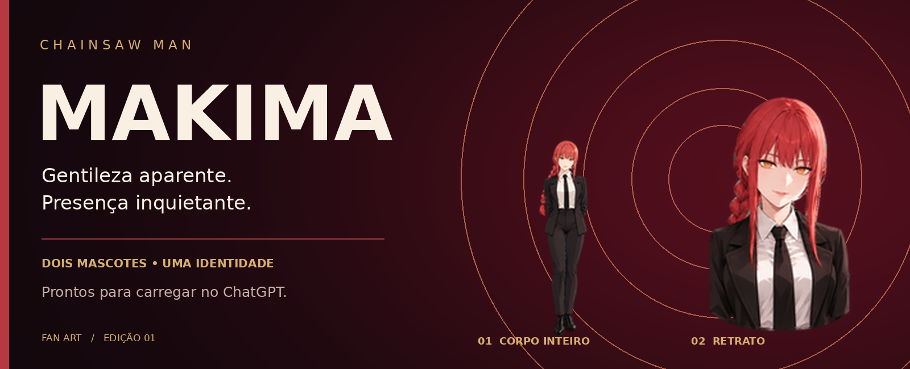
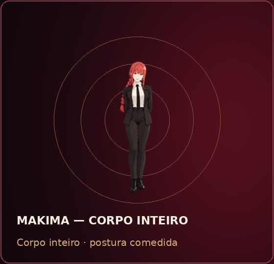
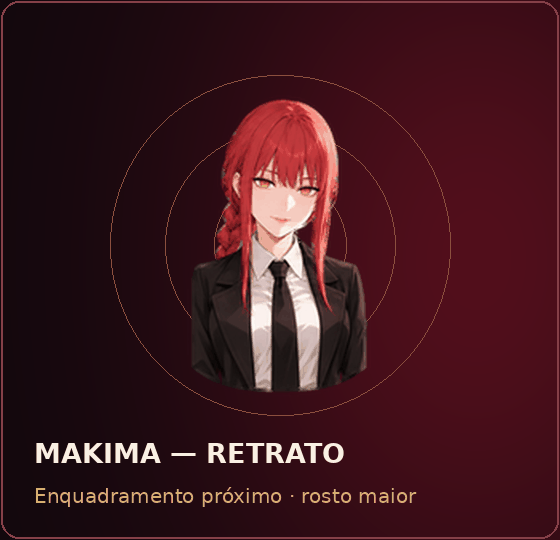
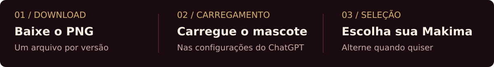

  

<strong>Serena. Enigmática. Sempre no controle.</strong> Makima, de <em>Chainsaw Man</em>, em duas versões animadas para acompanhar seu trabalho.

<a href="#escolha-sua-makima">Escolher mascote</a> · <a href="#carregar-no-chatgpt">Como carregar</a> · <a href="https://github.com/Arthurregiani/makima-chatgpt-pets/releases/tag/v1.0.0">Release e downloads</a>

> **Para começar:** baixe o PNG da versão que você prefere e selecione **Carregar um mascote** nas configurações do ChatGPT. Cada arquivo já está no formato de carregamento; a instalação acontece pela interface do ChatGPT.

## Escolha sua Makima

<table>
<tr>
<td align="center" width="50%"></td>
<td align="center" width="50%"></td>
</tr>
<tr>
<td align="center"><strong>01 · Original</strong> Corpo inteiro, silhueta elegante e postura comedida.</td>
<td align="center"><strong>02 · Retrato</strong> Rosto maior, olhar atento e presença mais próxima.</td>
</tr>
<tr>
<td align="center"> PNG transparente · 0,84 MiB</td>
<td align="center"> PNG transparente · 2,03 MiB</td>
</tr>
</table>

Trança ruiva, franja emoldurando o rosto, olhos dourados com anéis concêntricos, camisa branca, gravata preta e roupa social escura. A miniaturização muda a escala; a expressão tranquila e a autoridade inquietante continuam reconhecíveis.

**Quer os dois?** [Baixe o pacote com os dois PNGs](https://github.com/Arthurregiani/makima-chatgpt-pets/releases/download/v1.0.0/makima-chatgpt-upload.zip), extraia o ZIP e carregue cada imagem separadamente.

## Carregar no ChatGPT

### 1. Baixe o arquivo certo

Use um dos botões acima. Você só precisa de **um PNG para cada mascote**:

| Sua escolha | Arquivo que deve ser carregado |
| :--- | :--- |
| Makima · Original | `makima-chatgpt.png` |
| Makima · Retrato | `makima-retrato-chatgpt.png` |

Salve o arquivo como PNG no seu computador. Se abriu uma imagem no navegador, use **Salvar imagem como…**. Preserve a imagem inteira, com sua transparência e dimensões originais.

### 2. Abra o seletor de mascotes

No **ChatGPT na web**, abra o menu do seu perfil e vá a:

**Configurações → Personalização → Mascote → Selecionar mascote**

Em interfaces em inglês: **Settings → Personalization → Pet → Select pet**. Os rótulos podem variar conforme o idioma e a versão da interface.

### 3. Use “Carregar um mascote”

No seletor, clique em **Carregar um mascote** — **Upload pet**, em inglês. Selecione o PNG que você baixou e conclua o carregamento indicado pela interface. Se houver um campo de nome, use **Makima** ou **Makima — Retrato**.

Carregue o **PNG**, não o ZIP, o GIF de demonstração ou a imagem de capa deste README.

### 4. Selecione e use

Escolha o mascote recém-carregado no mesmo seletor. Ele aparece nos chats compatíveis do **ChatGPT Work**. Para ter as duas opções, repita o carregamento com o outro PNG; depois, alterne entre elas no seletor.

> **Disponibilidade:** o menu de mascotes depende da sua conta e do workspace. O mascote da web aparece dentro dos chats compatíveis. O companheiro flutuante do app desktop tem um fluxo próprio e não é o alvo deste tutorial. Escolher um mascote altera sua aparência; não muda a personalidade nem as respostas do ChatGPT.

## Uma release, apenas o necessário

A [release v1.0.0](https://github.com/Arthurregiani/makima-chatgpt-pets/releases/tag/v1.0.0) oferece:

- **`makima-chatgpt.png`** — carregamento da versão Original.
- **`makima-retrato-chatgpt.png`** — carregamento da versão Retrato.
- **`makima-chatgpt-upload.zip`** — os dois PNGs, sem prévias, relatórios ou arquivos de desenvolvimento.

Para carregar apenas um mascote, baixe somente o PNG correspondente. Os downloads **Source code** são gerados automaticamente pelo GitHub e contêm o repositório; prefira os arquivos nomeados acima.

## Compatibilidade verificada

| Característica | Arquivos desta release |
| :--- | :--- |
| Formato | PNG com canal de transparência |
| Dimensões | **1536 × 1872 px** |
| Layout | v1 · 8 colunas × 9 linhas |
| Animações | 9 estados · 57 quadros |
| Células sem uso | 15, totalmente transparentes |
| Tamanho | Ambos abaixo do limite de 20 MiB |

As versões de carregamento preservam, pixel a pixel, as nove linhas de animação das artes originais. As duas linhas adicionais de direção do olhar pertencem às folhas v2 e foram omitidas nesta exportação, sem redimensionar os sprites. As folhas v2 e as prévias completas continuam em [`assets/`](assets/).

[Detalhes da exportação e validação](docs/compatibilidade.md) · [Documentação oficial de Pets no ChatGPT](https://learn.chatgpt.com/docs/pets)

## Precisa de ajuda?

<strong>O ChatGPT rejeitou o arquivo</strong>

Confira se você escolheu `makima-chatgpt.png` ou `makima-retrato-chatgpt.png` da release. As folhas chamadas `spritesheet.png` em `assets/` são v2, com altura diferente. Baixe novamente o PNG da release se um editor ou serviço de mensagens tiver alterado suas dimensões ou transparência.

<strong>Não aparece “Carregar um mascote”</strong>

O recurso precisa estar disponível para sua conta e habilitado no workspace. Confira o caminho de configurações acima e a [documentação oficial](https://learn.chatgpt.com/docs/pets). Baixar a arte não habilita o recurso em uma conta que ainda não tenha acesso.

<strong>Baixei o ZIP. O que faço agora?</strong>

Extraia o arquivo. Você verá apenas dois PNGs. Carregue um deles pelo seletor de mascotes e repita com o segundo se quiser ambas as opções.

<strong>O mascote está parado</strong>

Os arquivos incluem animações. A interface pode usar uma imagem estática quando a redução de movimento está habilitada. Verifique as configurações de acessibilidade do seu sistema e o contexto em que o mascote está sendo exibido.

---

<strong>Uma presença discreta. Um olhar que observa.</strong> Projeto de fã · Makima / Chainsaw Man · Sem afiliação oficial com OpenAI ou os titulares da obra.

Makima e *Chainsaw Man* pertencem aos respectivos criadores e titulares de direitos. Este projeto compartilha mascotes de fã e não concede direitos sobre a personagem ou a obra.
