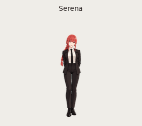
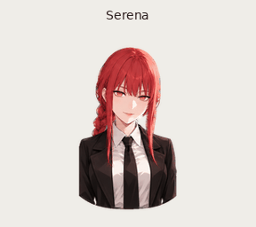

# Makima — pets animados para ChatGPT

Dois pets v2 da Makima, de *Chainsaw Man*, com spritesheets transparentes e prévias animadas. O primeiro tem enquadramento de corpo inteiro; **Makima — Retrato** tem enquadramento próximo e rosto maior. Os dois preservam a trança ruiva, os olhos dourados anelados e o traje social escuro.

> Escolher um pet muda sua aparência, não as respostas nem as capacidades do ChatGPT. A disponibilidade depende do app, da conta e das configurações do workspace.

## Prévia

| Makima | Makima — Retrato |
| --- | --- |
|  |  |

## Usar no ChatGPT

### Alternar entre os dois pets desta conta

1. No app ChatGPT, abra o menu do perfil e selecione **Pets** (ou vá a **Settings > Pets**).
2. Escolha **Makima** ou **Makima — Retrato** na lista de pets personalizados.
3. No app desktop para macOS ou Windows, use `/pet` ou **Show pet** no menu de comandos para exibir/ocultar o pet flutuante.
4. Para redimensionar o pet, abra **Settings > Pets > Customize > Pet size**.

Os dois pets desta conversa já foram adicionados à conta que os criou. Em outra conta, é preciso instalar cada pet separadamente.

### Instalar em outro app desktop

Os links abaixo abrem o fluxo de instalação do pet no app desktop ChatGPT, quando esse recurso e o esquema de links `codex://` estão habilitados. Abra o link e conclua a instalação que aparecer no app. A folha v2 tem 1536 × 2288 pixels, transparência e menos de 20 MiB.

- [Instalar Makima](codex://pets/install?name=Makima&imageUrl=https%3A%2F%2Fraw.githubusercontent.com%2FArthurregiani%2Fmakima-chatgpt-pets%2Fmain%2Fassets%2Fmakima%2Fspritesheet.png&description=Makima%20de%20Chainsaw%20Man%3A%20tranca%20ruiva%2C%20olhos%20dourados%20anelados%20e%20traje%20social.&spriteVersionNumber=2)
- [Instalar Makima — Retrato](codex://pets/install?name=Makima%20%E2%80%94%20Retrato&imageUrl=https%3A%2F%2Fraw.githubusercontent.com%2FArthurregiani%2Fmakima-chatgpt-pets%2Fmain%2Fassets%2Fmakima-retrato%2Fspritesheet.png&description=Makima%20em%20enquadramento%20pr%C3%B3ximo%2C%20com%20rosto%20e%20olhos%20dourados%20anelados%20em%20destaque.&spriteVersionNumber=2)

Se o link não abrir, baixe o `spritesheet.png` correspondente e use o fluxo **Create pet** no app desktop, se disponível. O seletor de upload pela web documentado pelo ChatGPT especifica a folha v1 (1536 × 1872); estas artes são v2, por isso os links de instalação desktop são a opção indicada.

## Arquivos

Cada pasta em `assets/` contém:

- `spritesheet.png` — folha transparente v2 para instalação;
- `preview.gif` e `preview.mp4` — demonstração animada;
- `contact-sheet.png` — todas as animações;
- `idle-jump-idle.gif` — demonstração de movimento vertical;
- `look-loop.gif` — ciclo com os 16 olhares.

## Referência oficial

- [Pets no ChatGPT](https://learn.chatgpt.com/docs/pets) — escolher, mostrar e redimensionar pets; diferenças entre desktop e web.
- [Comandos e links profundos](https://learn.chatgpt.com/docs/reference/commands#pets) — fluxo `codex://pets/install` e parâmetro de versão v2.

## Créditos

Pet de fã, sem afiliação oficial. Makima e *Chainsaw Man* pertencem aos respectivos criadores e titulares de direitos. Este repositório compartilha as folhas e prévias para uso pessoal no ChatGPT; não concede direitos sobre a personagem ou a obra.
